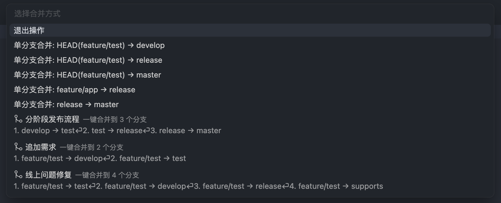

# Git Quick Merge

---

快速将当前分支合并到指定分支，无需切换分支。

A VSCode extension for quickly merging the current branch to specified branches without switching branches.



### 工作原理 / How It Works

本扩展的合并操作大致等同于以下 Git 命令序列：

This extension's merge operation is roughly equivalent to the following Git command sequence:
```bash
git checkout B -> git pull -> git merge A -> git push -> git checkout A
```

但是使用 `git worktree` 技术实现，**不会对本地分支做任何修改**，确保您的当前工作环境完全不受影响。

However, it uses `git worktree` technology, ensuring **no modifications are made to your local branches** and your current working environment remains completely unaffected.

### Features

- **快速分支合并**：无需切换到目标分支，直接将当前分支合并到指定分支
- **Quick Branch Merge**: Merge current branch to specified target branches without switching away from your current branch

- **预设多分支合并**：配置预设的分支组合，一键合并到多个目标分支（如配置"HotFix"包含 develop+master）
- **Preset Multiple Branch Merge**: Configure preset branch combinations for one-click merging to multiple target branches (e.g., configure "HotFix" with develop+master)

- **无干扰**：使用 git worktree，当前工作目录文件不会被变更，不会中断或影响正在进行的构建/开发环境
- **Non-disruptive**: Uses git worktree to ensure files in your current working directory remain unchanged, preventing interruption to ongoing builds or development environments

- **自定义目标分支**：在设置中配置你常用的目标分支（develop、release、master 等），支持字符串或对象格式，可指定源分支
- **Configurable Target Branches**: Set up your preferred target branches (develop, release, master, etc.) in settings, supports string or object format with optional source branch specification

- **历史残留清理**：自动检测并清理失败残留的 worktree 目录
- **Stale Worktree Cleanup**: Automatically detect and clean up leftover worktree directories

### 配置示例 / Configuration Examples

#### 单分支配置 / Single Branch Configuration
```json
{
  "gitQuickMerge.branches": [
    // 字符串格式：表示从当前分支合并到目标分支
    // String format: merge from current branch to target branch
    "develop",
    "release",
    "master",
    
    // 1.0.5 新增：对象格式：指定源分支和目标分支，如果全局修改，请确保所有编辑器实例都在 1.0.5 或以上版本
    // 1.0.5 Added: Object format: specify source and target branches，if you modify the global configuration, please ensure that all editor instances are at version 1.0.5 or above
    {
      // 忽略 from 时，使用当前分支
      // If from is ignored, use the current branch
      "to": "develop"
    },
    {
      "from": "release",
      "to": "master"
    },
    {
      "from": "feature/new-feature",
      "to": "develop"
    }
  ]
}
```

### 预设合并到多分支配置示例 / Merge Presets Configuration Example

```json
{
  "gitQuickMerge.mergePresets": [
    // 简单配置 (从当前分支合并) 
    // Simple Configuration (Merge from current branch)
    {
      "name": "测试环境",
      "branches": ["develop", "test"]
    },
    {
      "name": "预发布",
      "branches": ["develop", "release"]
    },
    {
      "name": "hotfix",
      "branches": ["develop", "release", "master"]
    },

    // 指定源分支
    // Specify source branch
    {
      "name": "分阶段发布流程",
      "branches": [
        { "from": "develop", "to": "test" },
        { "from": "test", "to": "staging" },
        { "from": "staging", "to": "production" }
      ]
    },
    {
      "name": "hotfix",
      "branches": [
        { "from": "hotfix/v1", "to": "develop" },
        { "from": "hotfix/v1", "to": "release" },
        { "from": "release", "to": "master" }
      ]
    }
  ]
}
```

**配置说明 / Configuration Notes:**
- 所有合并操作按配置顺序依次执行，每个操作使用独立的worktree确保安全
- All merge operations are executed in order according to the configuration, each operation uses an independent worktree to ensure safety
- 默认情况下，如果某个合并操作失败，整个流程会立即中断；可通过设置 `gitQuickMerge.continueOnError: true` 来改为跳过失败的操作继续执行
- By default, if a merge operation fails, the entire process will abort immediately; set `gitQuickMerge.continueOnError: true` to skip failed operations and continue

---

**Enjoy!**
